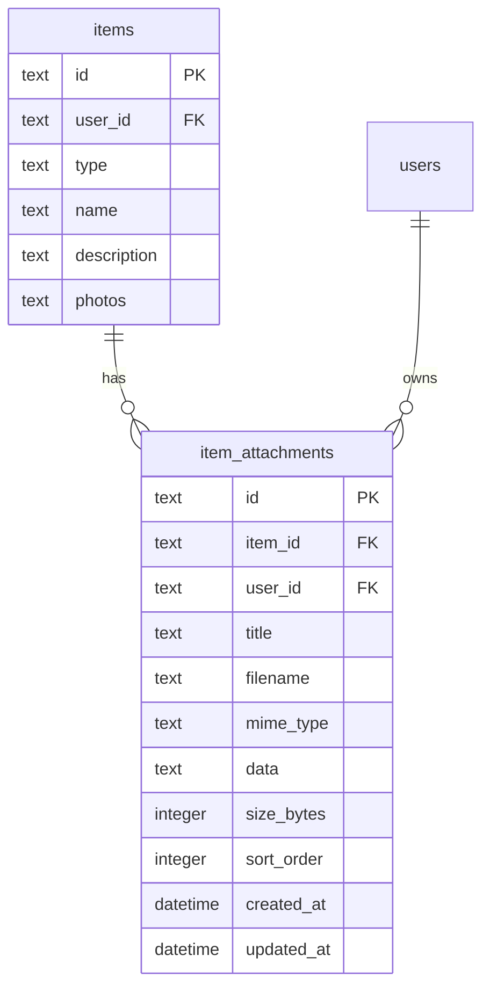

# feat: Add File Attachments to Items

## Overview

Add the ability to attach files (PDFs, images, documents) to items in SiFi. When scanning a QR code on a container or object, users can view associated documents like user manuals, purchase receipts, warranties, and notes.

## Problem Statement / Motivation

Physical items often have associated documentation:
- User manuals for appliances and electronics
- Purchase receipts and warranty information
- Maintenance records and notes
- Reference photos or diagrams

Currently, users must store these documents separately and mentally associate them with items. This feature enables "everything about an item in one place" - scan the QR code and see all related documents.

## Proposed Solution

Create a dedicated `item_attachments` table with:
- Base64-encoded file storage (consistent with existing photos pattern)
- User-defined titles for each attachment
- Manual sort order for organizing attachments
- Click-to-open behavior (browser handles file display)

### Data Model

```sql
CREATE TABLE item_attachments (
  id TEXT PRIMARY KEY,
  item_id TEXT NOT NULL REFERENCES items(id) ON DELETE CASCADE,
  user_id TEXT NOT NULL REFERENCES users(id),
  title TEXT NOT NULL,           -- User-defined label
  filename TEXT NOT NULL,        -- Original filename
  mime_type TEXT NOT NULL,       -- e.g., 'application/pdf'
  data TEXT NOT NULL,            -- Base64 encoded file content
  size_bytes INTEGER NOT NULL,   -- For display/validation
  sort_order INTEGER DEFAULT 0,  -- For manual ordering
  created_at DATETIME DEFAULT CURRENT_TIMESTAMP,
  updated_at DATETIME DEFAULT CURRENT_TIMESTAMP
);

CREATE INDEX idx_item_attachments_item ON item_attachments(item_id);
```



## Technical Considerations

### Storage Approach
- **Base64 in SQLite**: Consistent with existing photos field, self-contained database
- **File size target**: 5MB soft warning, 10MB hard limit
- Larger files should use external storage (out of scope for v1)

### File Type Handling
- Accept any file type (maximum flexibility)
- Browser handles display via data URL in new tab
- Common types: PDF, images, text files, office documents

### Photos vs Attachments
- **Photos**: Quick visual identification, displayed inline as thumbnails
- **Attachments**: Reference documents, displayed as list with titles
- Both can be images, but serve different purposes

### Performance
- Attachments loaded on-demand when viewing item details
- File data not included in list/search queries
- Index on `item_id` for efficient lookup

## Acceptance Criteria

### Core Functionality
- [x] Can attach any file type to an item
- [x] Each attachment has a user-defined title (defaults to filename)
- [x] Attachments display on item detail page in dedicated section
- [x] Click opens attachment in new browser tab
- [x] Can delete attachments
- [x] Can reorder attachments (drag-and-drop on desktop, move buttons on mobile)

### Validation & Limits
- [x] File size warning at 5MB
- [x] Hard limit at 10MB with clear error message
- [x] Title required (cannot be empty)

### UX
- [x] Loading indicator during upload
- [x] File icon based on mime type (PDF, image, document, generic)
- [x] Display file size in human-readable format
- [x] Confirm before delete

## Success Metrics

- Users can attach and retrieve documents from items
- Attachment upload completes in <3 seconds for typical files (<2MB)
- No data loss on cascade delete of parent item

## Dependencies & Prerequisites

- Existing item detail page infrastructure
- Base64 encoding utilities (native browser APIs)
- File input handling (already used for photos)

## Implementation Phases

### Phase 1: Database Layer

**Files:**
- `src/lib/db/schema.sql` - Add item_attachments table
- `src/lib/db/attachments.ts` - New file for attachment operations
- `src/types/domain.ts` - Add Attachment types

**Pattern to follow:** `src/lib/db/activity-items.ts:1-80` for junction-style operations

```typescript
// src/types/domain.ts additions
export interface Attachment {
  id: string;
  itemId: string;
  userId: string;
  title: string;
  filename: string;
  mimeType: string;
  data: string;
  sizeBytes: number;
  sortOrder: number;
  createdAt: string;
  updatedAt: string;
}

export interface NewAttachment {
  itemId: string;
  userId: string;
  title: string;
  filename: string;
  mimeType: string;
  data: string;
  sizeBytes: number;
}

// For list display (without file data)
export interface AttachmentMeta {
  id: string;
  itemId: string;
  title: string;
  filename: string;
  mimeType: string;
  sizeBytes: number;
  sortOrder: number;
  createdAt: string;
}
```

**Database operations:**
- `createAttachment(data: NewAttachment): Attachment`
- `getAttachmentById(id: string, userId: string): Attachment | undefined`
- `getAttachmentsForItem(itemId: string, userId: string): AttachmentMeta[]`
- `updateAttachment(id: string, userId: string, data: Partial<{title, sortOrder}>)`
- `deleteAttachment(id: string, userId: string): boolean`
- `reorderAttachments(itemId: string, userId: string, orderedIds: string[])`

### Phase 2: Server Actions

**Files:**
- `src/actions/attachments.ts` - New file for attachment actions

**Pattern to follow:** `src/actions/activity-items.ts:1-60`

```typescript
// Zod schemas
const createAttachmentSchema = z.object({
  itemId: z.string().uuid(),
  title: z.string().min(1).max(255),
  filename: z.string().min(1),
  mimeType: z.string().min(1),
  data: z.string(), // Base64
  sizeBytes: z.number().int().positive().max(10 * 1024 * 1024), // 10MB max
});

const updateAttachmentSchema = z.object({
  id: z.string().uuid(),
  title: z.string().min(1).max(255).optional(),
});

const reorderAttachmentsSchema = z.object({
  itemId: z.string().uuid(),
  orderedIds: z.array(z.string().uuid()),
});
```

**Actions:**
- `createAttachment(data)` - Create with validation
- `getAttachmentsForItem(itemId)` - List metadata only
- `getAttachmentData(id)` - Full attachment with data (for viewing)
- `updateAttachment(data)` - Update title
- `deleteAttachment(id)` - Delete with confirmation
- `reorderAttachments(data)` - Update sort_order for all

### Phase 3: UI Components

**Files:**
- `src/components/attachments/attachment-list.tsx` - Display attachments
- `src/components/attachments/attachment-item.tsx` - Single attachment row
- `src/components/attachments/add-attachment-dialog.tsx` - Upload interface
- `src/components/attachments/index.ts` - Exports

**Pattern to follow:**
- `src/components/items/item-form-dialog.tsx:89-130` for file input handling
- `src/components/activities/activity-items.tsx:1-80` for list with reordering

**attachment-list.tsx:**
- Section header "Attachments" with count
- "Add Attachment" button
- List of AttachmentItem components
- Drag handles for reordering (desktop)
- Empty state: "No attachments yet"

**attachment-item.tsx:**
- File type icon (based on mime type)
- Title (editable inline or via dialog)
- Filename and size display
- Click handler to open in new tab
- Delete button with confirmation
- Drag handle for reordering

**add-attachment-dialog.tsx:**
- File picker (any type)
- Title input (defaults to filename without extension)
- File size display with warning/error states
- Upload button with loading state
- Cancel button

### Phase 4: Integration

**Files:**
- `src/app/(app)/items/[id]/item-detail-view.tsx` - Add Attachments section

**Integration points:**
- Add Attachments section between Photos and QR Code sections
- Load attachments on page load (metadata only)
- Handle add/edit/delete/reorder operations
- Refresh list after mutations

```tsx
// In item-detail-view.tsx, after Photos section:
{/* Attachments */}
<AttachmentList
  itemId={item.id}
  attachments={attachments}
  onAttachmentAdded={reloadAttachments}
  onAttachmentDeleted={reloadAttachments}
  onReorder={handleReorder}
/>
```

## File Icons Mapping

```typescript
const FILE_ICONS = {
  'application/pdf': FileText,        // PDF icon
  'image/': Image,                    // Image icon (prefix match)
  'text/': FileText,                  // Text files
  'application/msword': FileText,     // Word docs
  'application/vnd.openxmlformats': FileText, // Office docs
  'default': File,                    // Generic file
};
```

## Edge Cases & Error Handling

1. **Upload fails mid-way**: Show error, allow retry, don't create partial record
2. **File too large**: Show error before upload attempt, don't send data
3. **Invalid file type**: Allow all types (browser handles display)
4. **Duplicate filenames**: Allow (different attachments can have same filename)
5. **Item deleted**: CASCADE delete removes all attachments
6. **Network error on view**: Show error toast, keep item in list

## Testing Checklist

- [ ] Create attachment with PDF
- [ ] Create attachment with image
- [ ] Create attachment with unusual file type
- [ ] Title defaults to filename
- [ ] Custom title saves correctly
- [ ] File opens in new tab
- [ ] Reorder via drag (desktop)
- [ ] Reorder via buttons (mobile)
- [ ] Delete with confirmation
- [ ] 5MB file shows warning but allows upload
- [ ] 10MB+ file blocked with error
- [ ] Attachments deleted when item deleted

## References & Research

### Internal References
- Photo upload pattern: `src/components/items/item-form-dialog.tsx:89-130`
- Junction table pattern: `src/lib/db/activity-items.ts`
- Server action pattern: `src/actions/activity-items.ts`
- List with actions: `src/components/activities/activity-items.tsx`

### Brainstorm Document
- `docs/brainstorms/2026-01-31-item-attachments-brainstorm.md`

## Open Questions Resolved

| Question | Decision |
|----------|----------|
| File size limit | 10MB hard, 5MB warning |
| Duplicate detection | Allow duplicates |
| Bulk upload | v2 feature |
| Photo vs attachment overlap | Both serve different purposes, allow overlap |
