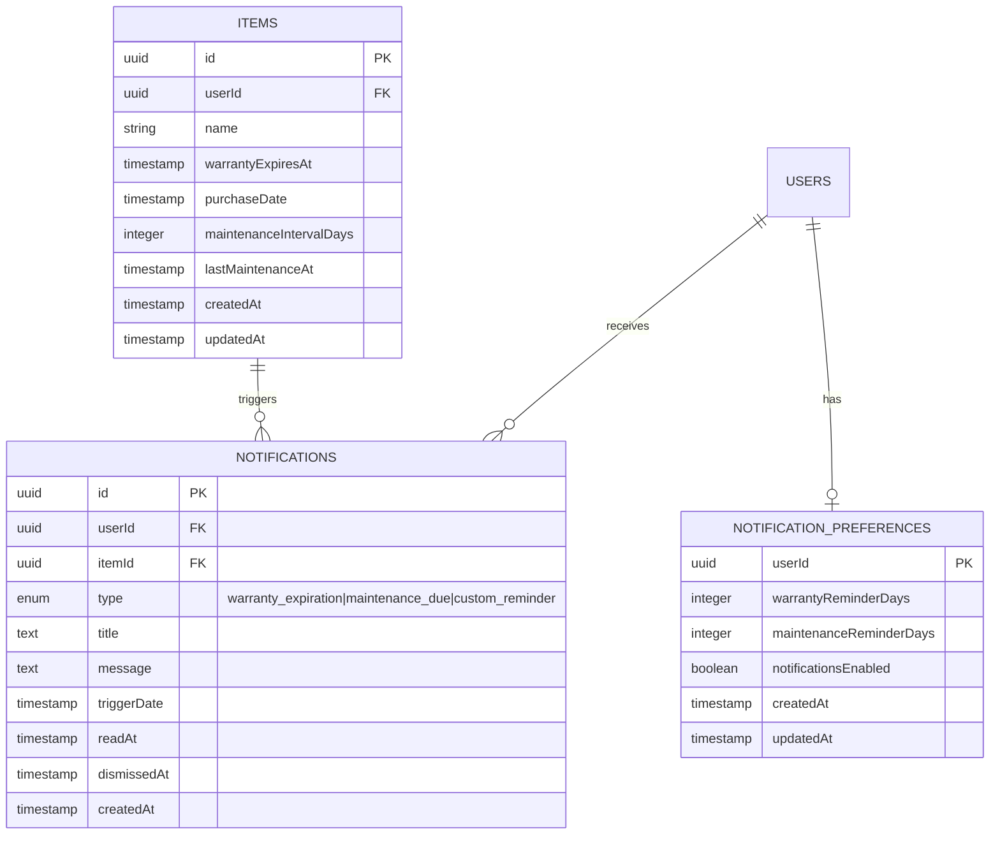

# Notifications: Release 2

## Overview

In-app notification system for SiFi with warranty expiration reminders, maintenance due alerts, and custom user-defined reminders. Notifications appear via bell icon in header and dedicated notifications page.

**Goal:** Complete the "v1 promise" by giving users proactive reminders about their inventory items.

---

## Problem Statement

Users have no way to be reminded about important dates for their items:
- Warranties expire without notice
- Maintenance schedules are forgotten
- No proactive alerts for time-sensitive inventory information

This release adds a notification system that surfaces upcoming events before they become problems.

---

## Technical Context

**Current Stack:**
- Next.js 16 App Router + React 19
- PostgreSQL with Drizzle ORM
- Server actions for CRUD
- SWR for client-side data fetching
- Header component at `src/components/nav/header.tsx`

**Key Files:**
| Purpose | Path |
|---------|------|
| Database schema | `src/lib/db/schema.ts` |
| Header | `src/components/nav/header.tsx` |
| Settings page | `src/app/(app)/settings/page.tsx` |
| Item form | `src/components/items/item-form-dialog.tsx` |
| Server actions | `src/actions/` |

---

## User Requirements (from refinement)

- **Notification types:** Warranty expiration, Maintenance due, Custom reminders
- **UI location:** Bell icon in header + dedicated /notifications page
- **Reminder timing:** User-configurable days in advance (per notification type)

---

## Implementation Phases

### Phase 1: Database & Schema

**Scope:** Add date fields to items, create notifications table, preferences table

#### 1.1 Items Table Additions

Add optional date fields to track warranty and maintenance:

```typescript
// schema.ts - items table additions
warrantyExpiresAt: timestamp("warranty_expires_at"),
purchaseDate: timestamp("purchase_date"),
maintenanceIntervalDays: integer("maintenance_interval_days"),
lastMaintenanceAt: timestamp("last_maintenance_at"),
```

**Tasks:**
- [x] Add warranty/maintenance columns to items table in schema.ts
- [x] Create Drizzle migration
- [x] Run migration on development database
- [x] Update Item type in domain.ts

#### 1.2 Notifications Table

```typescript
// schema.ts - new notifications table
export const notificationTypeEnum = pgEnum("notification_type", [
  "warranty_expiration",
  "maintenance_due",
  "custom_reminder"
]);

export const notifications = pgTable("notifications", {
  id: uuid("id").defaultRandom().primaryKey(),
  userId: uuid("user_id").notNull().references(() => users.id, { onDelete: "cascade" }),
  itemId: uuid("item_id").references(() => items.id, { onDelete: "cascade" }),
  type: notificationTypeEnum("type").notNull(),
  title: text("title").notNull(),
  message: text("message"),
  triggerDate: timestamp("trigger_date").notNull(),
  readAt: timestamp("read_at"),
  dismissedAt: timestamp("dismissed_at"),
  createdAt: timestamp("created_at").defaultNow().notNull(),
}, (table) => [
  index("notifications_user_unread_idx").on(table.userId, table.readAt),
  uniqueIndex("notifications_item_type_date_idx").on(table.itemId, table.type, table.triggerDate),
]);
```

**Tasks:**
- [x] Add notification type enum to schema.ts
- [x] Add notifications table to schema.ts
- [x] Create migration
- [x] Add Notification type to domain.ts

#### 1.3 User Notification Preferences

```typescript
// schema.ts - notification preferences table
export const notificationPreferences = pgTable("notification_preferences", {
  userId: uuid("user_id").primaryKey().references(() => users.id, { onDelete: "cascade" }),
  warrantyReminderDays: integer("warranty_reminder_days").default(30),
  maintenanceReminderDays: integer("maintenance_reminder_days").default(7),
  notificationsEnabled: boolean("notifications_enabled").default(true),
  createdAt: timestamp("created_at").defaultNow().notNull(),
  updatedAt: timestamp("updated_at").defaultNow().notNull(),
});
```

**Tasks:**
- [x] Add notification_preferences table to schema.ts
- [x] Create migration
- [x] Add NotificationPreferences type to domain.ts

---

### Phase 2: Core Functionality

**Scope:** Server actions, notification generation, API routes

#### 2.1 Database Layer

Create database operations for notifications:

**File:** `src/lib/db/notifications.ts`

```typescript
// Key functions needed:
export async function getUnreadNotifications(userId: string): Promise<Notification[]>
export async function getNotificationCount(userId: string): Promise<number>
export async function markAsRead(notificationId: string, userId: string): Promise<void>
export async function markAllAsRead(userId: string): Promise<void>
export async function dismissNotification(notificationId: string, userId: string): Promise<void>
export async function createNotification(data: NewNotification): Promise<Notification>
export async function getNotificationPreferences(userId: string): Promise<NotificationPreferences | null>
export async function upsertNotificationPreferences(userId: string, prefs: Partial<NotificationPreferences>): Promise<void>
```

**Tasks:**
- [x] Create src/lib/db/notifications.ts
- [x] Implement all CRUD functions
- [x] Add proper user scoping on all queries

#### 2.2 Server Actions

**File:** `src/actions/notifications.ts`

```typescript
"use server";

export async function getNotifications(): Promise<ActionResult<NotificationsResponse>>
export async function markNotificationRead(id: string): Promise<ActionResult<void>>
export async function markAllNotificationsRead(): Promise<ActionResult<void>>
export async function dismissNotification(id: string): Promise<ActionResult<void>>
export async function updateNotificationPreferences(formData: FormData): Promise<ActionResult<void>>
export async function createCustomReminder(formData: FormData): Promise<ActionResult<Notification>>
```

**Tasks:**
- [x] Create src/actions/notifications.ts
- [x] Implement all server actions with auth checks
- [x] Add Zod validation for inputs

#### 2.3 Notification Generation (Cron Job)

Generate notifications from items with upcoming dates. Run daily.

**File:** `src/app/api/cron/generate-notifications/route.ts`

**Logic:**
1. Query items where warrantyExpiresAt is within user's reminder window
2. Query items where lastMaintenanceAt + maintenanceIntervalDays is within reminder window
3. For each, upsert notification (unique on itemId + type + triggerDate)
4. Return count of notifications created

**Tasks:**
- [x] Create API route for cron job
- [x] Implement warranty expiration check
- [x] Implement maintenance due check
- [x] Add deduplication via upsert
- [x] Add cron secret authentication
- [ ] Test with sample data

---

### Phase 3: UI Components

**Scope:** Bell icon, dropdown, notifications page, settings, item form updates

#### 3.1 Notification Bell Component

**File:** `src/components/notifications/notification-bell.tsx`

**Features:**
- Bell icon with unread count badge (show "99+" for >99)
- Click opens dropdown with 5 most recent
- "View all" link to /notifications

```tsx
// Hook for notifications with SWR polling
function useNotifications() {
  const { data, mutate } = useSWR('/api/notifications', fetcher, {
    refreshInterval: 30000, // 30 second polling
    revalidateOnFocus: true,
  });
  // ... mark read, dismiss with optimistic updates
}
```

**Tasks:**
- [x] Create useNotifications hook with SWR
- [x] Create NotificationBell component
- [x] Create NotificationDropdown component
- [x] Create NotificationItem component
- [x] Add bell to header.tsx (between ScanButton and UserMenu)

#### 3.2 Notifications Page

**File:** `src/app/(app)/notifications/page.tsx`

**Features:**
- Full list of notifications (paginated, 20 per page)
- Filter: All / Unread / Read
- Bulk actions: Mark all as read
- Click notification to navigate to item
- Empty state when no notifications

**Tasks:**
- [x] Create notifications page
- [ ] Add pagination
- [ ] Add filter tabs
- [x] Add bulk mark as read
- [x] Add empty state

#### 3.3 Settings Integration

Update existing settings page with notification preferences:

**Tasks:**
- [x] Replace placeholder in settings page
- [x] Add warranty reminder days input (1-365)
- [x] Add maintenance reminder days input (1-365)
- [x] Add master enable/disable toggle
- [x] Save preferences via server action

#### 3.4 Item Form Updates

Add date fields to item edit form:

**Fields to add:**
- Purchase Date (optional date picker)
- Warranty Expires (optional date picker)
- Maintenance Interval (optional number, days)
- Last Maintenance (optional date picker)

**Tasks:**
- [x] Add date fields to ItemFormDialog
- [x] Add maintenance interval field
- [x] Update item server actions to handle new fields
- [ ] Show fields in item detail view

#### 3.5 Custom Reminder Creation

Allow users to create one-time reminders from item detail:

**Tasks:**
- [ ] Add "Set Reminder" button to item detail
- [ ] Create reminder dialog (date picker + optional message)
- [ ] Create server action for custom reminders

---

## Data Model (ERD)



---

## Key Design Decisions

| Decision | Choice | Rationale |
|----------|--------|-----------|
| Polling vs WebSocket | 30s SWR polling | Simpler, no infrastructure needed |
| Notification generation | Daily cron job | Predictable, efficient batch processing |
| Deduplication | Unique constraint on (item, type, date) | Prevents duplicate notifications |
| Cascade delete | ON DELETE CASCADE for item FK | Orphaned notifications auto-cleaned |
| Read vs Dismiss | Read = counted, visible; Dismiss = hidden | Clear semantics |
| Timing defaults | Warranty: 30 days, Maintenance: 7 days | Sensible defaults |
| Badge overflow | Show "99+" | Clean UI for power users |

---

## Acceptance Criteria

### Phase 1: Database
- [x] Items table has warranty/maintenance date columns
- [x] Notifications table exists with proper indexes
- [x] Preferences table exists
- [x] Migrations run successfully

### Phase 2: Core Functionality
- [x] Server actions work for CRUD operations
- [x] Cron job generates notifications correctly
- [x] Deduplication prevents duplicates
- [x] Cascade delete cleans up on item deletion

### Phase 3: UI
- [x] Bell icon visible in header with badge
- [x] Dropdown shows recent notifications
- [x] /notifications page lists all notifications
- [x] Settings allow configuring timing
- [x] Item form has date fields
- [x] Custom reminders can be created

---

## Edge Cases Addressed

| Edge Case | Handling |
|-----------|----------|
| Item deleted with pending notifications | CASCADE delete removes notifications |
| Duplicate cron runs | Unique constraint prevents duplicates |
| User ignores expired warranty | No repeat notifications (one-time trigger) |
| 100+ unread notifications | Badge shows "99+" |
| Network failure during polling | SWR shows last known count |
| No warranty date set | No notification generated |

---

## What's NOT in This Release

Deferred to future releases:

| Feature | Reason |
|---------|--------|
| Email notifications | MVP is in-app only |
| Push notifications | Requires service worker |
| Recurring custom reminders | Complex, custom is one-time for MVP |
| Multiple timing per type | Single timing per type for MVP |
| Per-item timing override | Global preferences only for MVP |
| Snooze functionality | Add based on user feedback |

---

## Migration Notes

**Database changes:**
- 3 new columns on items table (nullable, no data migration needed)
- 2 new tables (notifications, notification_preferences)

**Existing data:**
- Existing items have no warranty/maintenance dates (null = no notifications)
- No migration of existing data required

**Cron setup:**
- Requires external cron service (Vercel Cron, Railway Cron, etc.)
- Endpoint: `/api/cron/generate-notifications`
- Schedule: Daily at 6 AM UTC
- Requires CRON_SECRET environment variable

---

## References

### Internal
- Roadmap brainstorm: `docs/brainstorms/2026-02-01-comprehensive-roadmap-brainstorm.md`
- Existing patterns: `src/actions/items.ts`, `src/lib/db/items.ts`

### External
- SWR documentation: https://swr.vercel.app
- Drizzle ORM: https://orm.drizzle.team
- Vercel Cron: https://vercel.com/docs/cron-jobs
