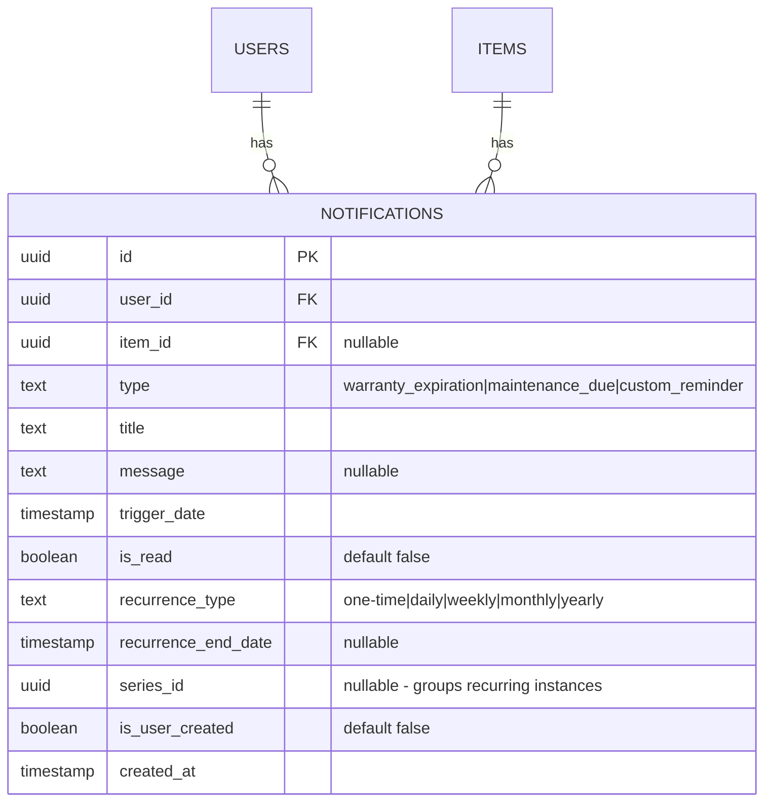

# Item-Level Custom Notifications

## Overview

Enhance the SiFi notification system from universal settings to item-level custom notifications with full CRUD capabilities, recurrence support, and a dedicated UI on item detail pages.

## Problem Statement

**Current State:**
- Notifications are configured globally in Settings with universal values
- Only auto-generated notifications exist (warranty expiration, maintenance due)
- The `custom_reminder` type exists in schema but has no UI
- Users cannot create item-specific reminders with custom schedules

**User Need:**
- "Remind me to check the furnace filter every 3 months"
- "Alert me when the car registration is due next March"
- "Notify me weekly to water the plants in the garage"

## Proposed Solution

### Core Features

1. **Item-Level Reminders** - Create custom notifications attached to specific items
2. **Flexible Scheduling** - One-time or recurring (daily, weekly, monthly, yearly)
3. **Full CRUD** - Create, view, edit, and delete reminders from item detail page
4. **Unified Notification Experience** - Custom reminders appear in notification bell alongside auto-generated

### Key Decisions

| Decision | Choice | Rationale |
|----------|--------|-----------|
| Recurrence storage | Add columns to existing `notifications` table | Simpler than separate table, keeps queries straightforward |
| Recurring trigger behavior | Create new notification record for next occurrence | Maintains notification history, simpler than updating in-place |
| End date | Optional | Users may want indefinite reminders; add sensible max (2 years) |
| Global reminders | Not in v1 | Keep focus on inventory items; simpler mental model |
| Edit scope for recurring | Affects future instances only | Matches user expectation from calendar apps |
| Auto-generated editability | Read-only (can dismiss) | Prevents conflicts with source data |
| Timezone | Store UTC, display local | Standard best practice |

---

## Technical Approach

### Database Schema Changes

```sql
-- Migration: 0003_add-notification-recurrence.sql

-- Add recurrence fields to notifications table
ALTER TABLE notifications ADD COLUMN recurrence_type TEXT
  CHECK (recurrence_type IN ('one-time', 'daily', 'weekly', 'monthly', 'yearly'))
  DEFAULT 'one-time';

ALTER TABLE notifications ADD COLUMN recurrence_end_date TIMESTAMP;

ALTER TABLE notifications ADD COLUMN series_id UUID;

ALTER TABLE notifications ADD COLUMN is_user_created BOOLEAN DEFAULT false NOT NULL;

-- Index for cron job efficiency
CREATE INDEX IF NOT EXISTS idx_notifications_pending
  ON notifications(trigger_date, is_read)
  WHERE is_read = false;
```

**New Fields:**
- `recurrence_type` - 'one-time' | 'daily' | 'weekly' | 'monthly' | 'yearly'
- `recurrence_end_date` - When to stop creating new occurrences (nullable)
- `series_id` - Groups all instances of a recurring notification
- `is_user_created` - Distinguishes custom from auto-generated

### Architecture

```
┌─────────────────────────────────────────────────────────────┐
│                    Item Detail Page                          │
│  ┌─────────────────────────────────────────────────────┐    │
│  │  Reminders Section (like Attachments)               │    │
│  │  ┌──────────────────────────────────────────────┐   │    │
│  │  │ 🔔 Check furnace filter    Monthly   Mar 15  │   │    │
│  │  │    [Edit] [Delete]                           │   │    │
│  │  ├──────────────────────────────────────────────┤   │    │
│  │  │ 🔔 Car registration due    One-time  Mar 1   │   │    │
│  │  │    [Edit] [Delete]                           │   │    │
│  │  ├──────────────────────────────────────────────┤   │    │
│  │  │ ⚙️ Warranty expires        Auto      Dec 31  │   │    │
│  │  │    (read-only - auto-generated)              │   │    │
│  │  └──────────────────────────────────────────────┘   │    │
│  │  [+ Add Reminder]                                   │    │
│  └─────────────────────────────────────────────────────┘    │
└─────────────────────────────────────────────────────────────┘
```

---

## Implementation Phases

### Phase 1: Schema & Data Layer
**Estimated complexity: Low**

- [ ] Create migration `0003_add-notification-recurrence.sql`
- [ ] Update `src/lib/db/schema.ts` with new columns
- [ ] Update `src/types/domain.ts` with recurrence types
- [ ] Add database functions in `src/lib/db/notifications.ts`:
  - `createItemReminder()`
  - `updateItemReminder()`
  - `deleteItemReminder()`
  - `getItemReminders(itemId)`

**Files:**
- `drizzle/0003_add-notification-recurrence.sql`
- `src/lib/db/schema.ts`
- `src/lib/db/notifications.ts`
- `src/types/domain.ts`

### Phase 2: Server Actions
**Estimated complexity: Low**

- [ ] Add Zod schemas for reminder validation
- [ ] Create `createItemReminder` action
- [ ] Create `updateItemReminder` action
- [ ] Create `deleteItemReminder` action
- [ ] Create `getItemReminders` action (returns all reminders for an item)

**Files:**
- `src/actions/notifications.ts`

### Phase 3: Reminder List Component
**Estimated complexity: Medium**

- [ ] Create `ReminderList` component (similar to `AttachmentList`)
- [ ] Create `ReminderItem` component for list rows
- [ ] Display both custom and auto-generated notifications
- [ ] Visual differentiation (icon/badge for type)
- [ ] Edit/delete buttons for custom reminders only
- [ ] Empty state with CTA

**Files:**
- `src/components/reminders/reminder-list.tsx`
- `src/components/reminders/reminder-item.tsx`
- `src/components/reminders/index.ts`

### Phase 4: Reminder Form Dialog
**Estimated complexity: Medium**

- [ ] Create `ReminderFormDialog` component
- [ ] Form fields: title, trigger date/time, recurrence type, end date (optional), message
- [ ] Date/time picker integration
- [ ] Recurrence selector with preview ("Repeats every week")
- [ ] Edit mode (pre-populate fields)
- [ ] Validation (future dates only, required fields)

**Files:**
- `src/components/reminders/reminder-form-dialog.tsx`

### Phase 5: Integration with Item Detail Page
**Estimated complexity: Low**

- [ ] Add Reminders section to item detail view
- [ ] Position after attachments section
- [ ] Wire up refresh after create/edit/delete

**Files:**
- `src/app/(app)/items/[id]/item-detail-view.tsx`

### Phase 6: Recurring Notification Processing
**Estimated complexity: Medium**

- [ ] Update cron job to handle recurrence
- [ ] When recurring notification triggers:
  1. Mark current as read
  2. Calculate next trigger date
  3. Create new notification if within end_date
- [ ] Handle edge cases (month-end, leap year)
- [ ] Add `date-fns` helpers for recurrence calculation

**Files:**
- `src/app/api/cron/generate-notifications/route.ts`
- `src/lib/recurrence.ts` (new - date calculation helpers)

### Phase 7: Notification Bell Enhancement
**Estimated complexity: Low**

- [ ] Update notification dropdown to show custom reminders
- [ ] Add type indicator (icon or label)
- [ ] Link to source item when clicked

**Files:**
- `src/components/notifications/notification-dropdown.tsx`
- `src/app/(app)/notifications/notifications-list.tsx`

---

## Acceptance Criteria

### Functional Requirements

- [ ] User can create a one-time reminder for any item
- [ ] User can create a recurring reminder (daily, weekly, monthly, yearly)
- [ ] User can optionally set an end date for recurring reminders
- [ ] User can view all reminders (custom + auto-generated) on item detail page
- [ ] User can edit custom reminders (title, date, recurrence, message)
- [ ] User can delete custom reminders
- [ ] Auto-generated notifications are read-only (cannot edit/delete)
- [ ] Custom reminders appear in notification bell when triggered
- [ ] Recurring reminders auto-create next occurrence when triggered
- [ ] Deleting an item cascades to delete all its reminders

### Non-Functional Requirements

- [ ] Form validates future dates only
- [ ] Reminders list loads in < 200ms
- [ ] Maximum 50 active reminders per item
- [ ] Recurrence calculation handles month-end and leap years correctly

### Quality Gates

- [ ] Unit tests for recurrence date calculations
- [ ] Integration tests for CRUD operations
- [ ] E2E test for create-trigger-next-occurrence flow

---

## Edge Cases

| Scenario | Handling |
|----------|----------|
| Monthly reminder on Jan 31 | Next: Feb 28/29, then Mar 31 (last day of month if needed) |
| Yearly reminder on Feb 29 | Non-leap years: Feb 28 |
| End date in past when editing | Validation error |
| Item deleted with reminders | Cascade delete all notifications for item |
| Reminder trigger_date in past | Reject with validation error |
| Concurrent edits | Last write wins (acceptable for v1) |

---

## Dependencies & Risks

### Dependencies
- `date-fns` already installed (used elsewhere in app)
- Cron job infrastructure exists

### Risks

| Risk | Mitigation |
|------|------------|
| Schema migration on production | Add columns as nullable with defaults, no data loss |
| Cron job performance with many recurring | Index on trigger_date, batch processing |
| Complex recurrence bugs | Comprehensive test suite for date calculations |

---

## Future Considerations

**Not in v1, but architected to support:**
- Email/push notification delivery
- Global reminders (not attached to items)
- Snooze functionality
- Reminder templates
- Natural language input ("remind me in 2 weeks")

---

## ERD: Notification Schema Changes



---

## References

### Internal References
- Notification schema: `src/lib/db/schema.ts:187-217`
- Notification actions: `src/actions/notifications.ts`
- Cron job: `src/app/api/cron/generate-notifications/route.ts`
- Attachment list pattern: `src/components/attachments/attachment-list.tsx`
- Item form dialog pattern: `src/components/items/item-form-dialog.tsx`

### Existing Infrastructure
- `createCustomReminder` action exists but unused
- `custom_reminder` type exists in enum
- Notification bell with SWR polling at 30s interval
