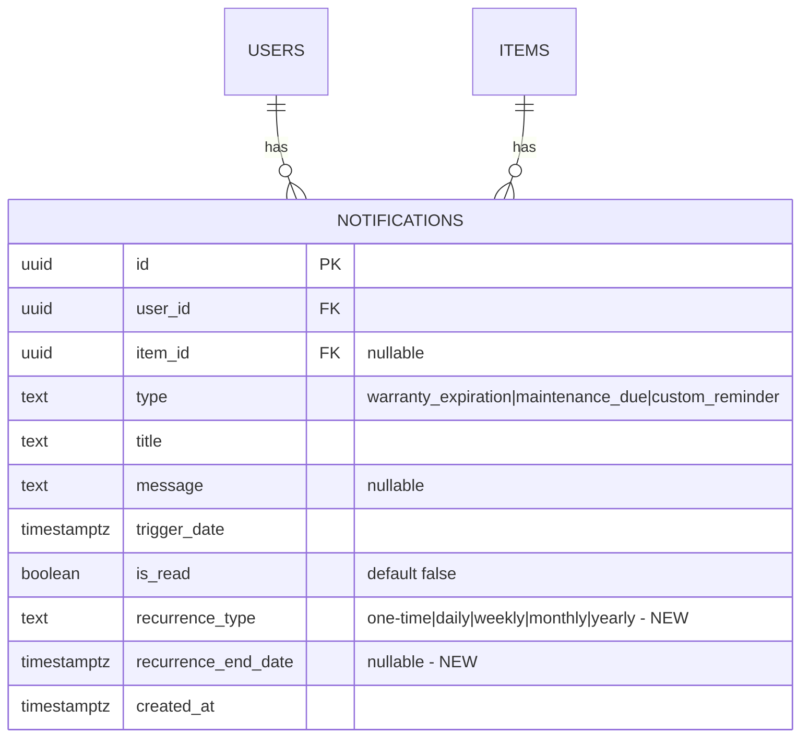

## Enhancement Summary

**Deepened on:** 2026-02-02
**Research agents used:** best-practices-researcher (UI patterns, recurring processing), kieran-typescript-reviewer, code-simplicity-reviewer, performance-oracle, architecture-strategist, Context7 (date-fns, Drizzle ORM)

### Key Improvements from Research

1. **Simplified schema** - Remove `series_id` and `is_user_created` columns (redundant with existing `type` enum)
2. **Critical index fix** - Existing unique index will block recurring notifications; must be modified
3. **TypeScript patterns** - Use discriminated unions for recurrence types, Zod schemas with refinements
4. **Performance optimizations** - Batch cron job processing, add comprehensive indexes, memoize date calculations
5. **UI best practices** - Progressive disclosure for recurrence selector, visual differentiation with icons/badges

### Research-Backed Decisions

| Decision | Research Source | Recommendation |
|----------|----------------|----------------|
| Recurrence calculation | RFC 5545 / rrule.js patterns | Use date-fns with month-end handling via `BYMONTHDAY=-1` semantics |
| UI pattern | Linear, Notion, Todoist analysis | Popover inbox with swipe actions, quick presets for date/time |
| Database queue | PostgreSQL SKIP LOCKED pattern | Batch processing prevents duplicate cron execution |
| TypeScript types | Discriminated union best practices | Eliminates invalid states at compile time |

---

# Item-Level Custom Notifications

## Overview

Enhance the SiFi notification system from universal settings to item-level custom notifications with full CRUD capabilities, recurrence support, and a dedicated UI on item detail pages.

## Problem Statement

**Current State:**
- Notifications are configured globally in Settings with universal values
- Only auto-generated notifications exist (warranty expiration, maintenance due)
- The `custom_reminder` type exists in schema but has no UI
- Users cannot create item-specific reminders with custom schedules

**User Need:**
- "Remind me to check the furnace filter every 3 months"
- "Alert me when the car registration is due next March"
- "Notify me weekly to water the plants in the garage"

## Proposed Solution

### Core Features

1. **Item-Level Reminders** - Create custom notifications attached to specific items
2. **Flexible Scheduling** - One-time or recurring (daily, weekly, monthly, yearly)
3. **Full CRUD** - Create, view, edit, and delete reminders from item detail page
4. **Unified Notification Experience** - Custom reminders appear in notification bell alongside auto-generated

### Key Decisions

| Decision | Choice | Rationale |
|----------|--------|-----------|
| Recurrence storage | Add columns to existing `notifications` table | Simpler than separate table, keeps queries straightforward |
| Recurring trigger behavior | Create new notification record for next occurrence | Maintains notification history, simpler than updating in-place |
| End date | Optional | Users may want indefinite reminders; add sensible max (2 years) |
| Global reminders | Not in v1 | Keep focus on inventory items; simpler mental model |
| Edit scope for recurring | Affects future instances only | Matches user expectation from calendar apps |
| Auto-generated editability | Read-only (can dismiss) | Prevents conflicts with source data |
| Timezone | Store UTC, display local | Standard best practice |

---

## Technical Approach

### Database Schema Changes

```sql
-- Migration: 0003_add-notification-recurrence.sql

-- Add recurrence fields to notifications table (simplified from original plan)
ALTER TABLE notifications ADD COLUMN recurrence_type TEXT
  CHECK (recurrence_type IN ('one-time', 'daily', 'weekly', 'monthly', 'yearly'))
  DEFAULT 'one-time';

ALTER TABLE notifications ADD COLUMN recurrence_end_date TIMESTAMPTZ;

-- CRITICAL: Drop existing unique index that will block recurring notifications
-- The existing (item_id, type, trigger_date) constraint prevents multiple instances
DROP INDEX IF EXISTS notifications_item_type_date_idx;

-- Index for cron job efficiency (pending notifications)
CREATE INDEX IF NOT EXISTS idx_notifications_pending
  ON notifications(trigger_date, is_read)
  WHERE is_read = false;

-- Index for getItemReminders(itemId) query
CREATE INDEX IF NOT EXISTS idx_notifications_item_id
  ON notifications(item_id)
  WHERE item_id IS NOT NULL;

-- Index for recurring notification processing
CREATE INDEX IF NOT EXISTS idx_notifications_recurring_due
  ON notifications(trigger_date, recurrence_type)
  WHERE recurrence_type != 'one-time';
```

**New Fields (Simplified):**
- `recurrence_type` - 'one-time' | 'daily' | 'weekly' | 'monthly' | 'yearly'
- `recurrence_end_date` - When to stop creating new occurrences (nullable = indefinite)

**Removed from original plan (YAGNI):**
- ~~`series_id`~~ - No user-facing feature uses series grouping; can add later if needed
- ~~`is_user_created`~~ - Redundant with existing `type === 'custom_reminder'` check

### Research Insights: Schema Design

**From architecture-strategist review:**
- Single-table approach is pragmatically sound for v1
- Adding columns vs. separate table: columns win for query simplicity
- Critical fix: existing unique index must be dropped/modified

**From code-simplicity-reviewer:**
- Original 4 columns reduced to 2 columns (~50% reduction)
- `is_user_created` is derivable from `type` enum
- `series_id` solves a problem that doesn't exist yet

### Architecture

```
┌─────────────────────────────────────────────────────────────┐
│                    Item Detail Page                          │
│  ┌─────────────────────────────────────────────────────┐    │
│  │  Reminders Section (like Attachments)               │    │
│  │  ┌──────────────────────────────────────────────┐   │    │
│  │  │ 🔔 Check furnace filter    Monthly   Mar 15  │   │    │
│  │  │    [Edit] [Delete]                           │   │    │
│  │  ├──────────────────────────────────────────────┤   │    │
│  │  │ 🔔 Car registration due    One-time  Mar 1   │   │    │
│  │  │    [Edit] [Delete]                           │   │    │
│  │  ├──────────────────────────────────────────────┤   │    │
│  │  │ ⚙️ Warranty expires        Auto      Dec 31  │   │    │
│  │  │    (read-only - auto-generated)              │   │    │
│  │  └──────────────────────────────────────────────┘   │    │
│  │  [+ Add Reminder]                                   │    │
│  └─────────────────────────────────────────────────────┘    │
└─────────────────────────────────────────────────────────────┘
```

---

## Implementation Phases (Consolidated)

**From code-simplicity-reviewer:** Original 7 phases consolidated to 3 phases for faster delivery and less context switching.

### Phase 1: Database + Actions
**Estimated complexity: Low-Medium** | **Estimated effort: 1-2 days**

#### Schema & Types
- [ ] Create migration `0003_add-notification-recurrence.sql`
- [ ] Update `src/lib/db/schema.ts` with new columns and indexes
- [ ] Update `src/types/domain.ts` with discriminated union types (see TypeScript section below)

#### Database Functions
- [ ] Extend existing `src/lib/db/notifications.ts`:
  - `getItemReminders(itemId)` - all reminders for an item (custom + auto)

#### Server Actions
- [ ] Extend existing `createCustomReminder` action (don't create new one)
- [ ] Add `updateItemReminder` action
- [ ] Add `deleteItemReminder` action
- [ ] Add Zod schemas with discriminated union validation

**Files:**
- `drizzle/0003_add-notification-recurrence.sql`
- `src/lib/db/schema.ts`
- `src/lib/db/notifications.ts`
- `src/types/domain.ts`
- `src/actions/notifications.ts`

### Research Insights: TypeScript Patterns

**From kieran-typescript-reviewer:**

```typescript
// src/types/domain.ts - Use discriminated unions for recurrence
export type RecurrenceFrequency = 'daily' | 'weekly' | 'monthly' | 'yearly';

export type RecurrenceConfig =
  | { type: 'one-time' }
  | { type: 'recurring'; frequency: RecurrenceFrequency; endDate: Date | null };

// Type guard for safe access
export function isRecurringNotification(
  notification: Notification
): notification is Notification & { recurrence: Extract<RecurrenceConfig, { type: 'recurring' }> } {
  return notification.recurrence.type === 'recurring';
}
```

```typescript
// src/lib/validations/reminder.ts - Zod schema with discriminated union
import { z } from 'zod';
import { isBefore, startOfDay } from 'date-fns';

const futureDateSchema = z.string().datetime().refine(
  (dateStr) => isBefore(startOfDay(new Date()), new Date(dateStr)),
  { message: 'Trigger date must be in the future' }
);

const recurrenceSchema = z.discriminatedUnion('type', [
  z.object({ type: z.literal('one-time') }),
  z.object({
    type: z.literal('recurring'),
    frequency: z.enum(['daily', 'weekly', 'monthly', 'yearly']),
    endDate: z.string().datetime().nullable(),
  }),
]);

export const createReminderSchema = z.object({
  itemId: z.string().uuid(),
  title: z.string().min(1, 'Title is required').max(200),
  message: z.string().max(500).optional(),
  triggerDate: futureDateSchema,
  recurrence: recurrenceSchema,
});

export type CreateReminderInput = z.infer<typeof createReminderSchema>;
```

---

### Phase 2: UI Components + Integration
**Estimated complexity: Medium** | **Estimated effort: 2-3 days**

#### Components
- [ ] Create `ReminderList` component with inline item rendering (no separate ReminderItem file)
- [ ] Create `ReminderFormDialog` component with create/edit modes
- [ ] Visual differentiation: 🔔 (custom) vs ⚙️ (auto-generated)
- [ ] Edit/delete buttons for `type === 'custom_reminder'` only

#### Integration
- [ ] Add Reminders section to `item-detail-view.tsx` (after attachments)
- [ ] Wire up refresh callback after create/edit/delete

**Files:**
- `src/components/reminders/reminder-list.tsx`
- `src/components/reminders/reminder-form-dialog.tsx`
- `src/app/(app)/items/[id]/item-detail-view.tsx`

### Research Insights: UI Patterns

**From best-practices-researcher (Linear, Notion, Todoist analysis):**

**Recurrence Selector - Progressive Disclosure Pattern:**
```
┌────────────────────────────────────────┐
│ Repeat: [Does not repeat ▼]            │
├────────────────────────────────────────┤
│ ○ Does not repeat                      │
│ ○ Daily                                │
│ ○ Weekly                               │
│ ○ Monthly                              │
│ ○ Yearly                               │
└────────────────────────────────────────┘
```

**Date/Time Picker - Quick Presets:**
```typescript
// Reduce friction with common scheduling patterns
const quickPresets = [
  { label: 'Tomorrow 9am', getValue: () => setHours(addDays(new Date(), 1), 9) },
  { label: 'Next week', getValue: () => addWeeks(new Date(), 1) },
  { label: 'In 2 weeks', getValue: () => addWeeks(new Date(), 2) },
  { label: 'Next month', getValue: () => addMonths(new Date(), 1) },
];
```

**Visual Differentiation:**

| Type | Icon | Color | Actions |
|------|------|-------|---------|
| User-created reminder | 🔔 | Primary (teal) | Edit, Delete |
| Auto-generated (warranty) | ⚙️ | Muted | Dismiss only |
| Auto-generated (maintenance) | 🔧 | Muted | Dismiss only |

**Component Structure (simplified):**
```typescript
// Single file with inline item rendering - no separate ReminderItem.tsx
function ReminderList({ itemId, reminders, onRemindersChange }: Props) {
  return (
    <div>
      {reminders.map((reminder) => (
        <div key={reminder.id} className="flex items-center gap-2 py-2">
          <span>{reminder.type === 'custom_reminder' ? '🔔' : '⚙️'}</span>
          <span className="flex-1 truncate">{reminder.title}</span>
          <span className="text-xs text-muted-foreground">
            {format(reminder.triggerDate, 'MMM d')}
          </span>
          {reminder.type === 'custom_reminder' && (
            <>
              <Button size="icon" variant="ghost" onClick={() => handleEdit(reminder)}>
                <Pencil className="h-4 w-4" />
              </Button>
              <Button size="icon" variant="ghost" onClick={() => handleDelete(reminder.id)}>
                <Trash className="h-4 w-4" />
              </Button>
            </>
          )}
        </div>
      ))}
      <Button variant="ghost" onClick={() => setFormOpen(true)}>
        <Plus className="h-4 w-4 mr-2" /> Add Reminder
      </Button>
    </div>
  );
}
```

---

### Phase 3: Recurrence Processing + Polish
**Estimated complexity: Medium** | **Estimated effort: 1-2 days**

#### Cron Job Updates
- [ ] Add recurring notification processing to existing cron job
- [ ] Batch processing with `SELECT FOR UPDATE SKIP LOCKED` pattern
- [ ] Calculate next occurrence using date-fns helpers

#### Notification Bell
- [ ] Update dropdown to show custom reminders with type indicator
- [ ] Link to source item when clicked

**Files:**
- `src/app/api/cron/generate-notifications/route.ts`
- `src/components/notifications/notification-dropdown.tsx`

### Research Insights: Recurrence Processing

**From best-practices-researcher (RFC 5545, calendar app patterns):**

```typescript
// src/lib/recurrence.ts - Date calculation helpers
import { addDays, addWeeks, addMonths, addYears, lastDayOfMonth, getDate, setDate, min } from 'date-fns';

type RecurrenceFrequency = 'daily' | 'weekly' | 'monthly' | 'yearly';

const frequencyAdders: Record<RecurrenceFrequency, (date: Date, amount: number) => Date> = {
  daily: addDays,
  weekly: addWeeks,
  monthly: addMonths,
  yearly: addYears,
};

/**
 * Calculates the next occurrence date for a recurring notification.
 * Handles month-end edge cases (Jan 31 -> Feb 28).
 */
export function calculateNextOccurrence(
  currentDate: Date,
  frequency: RecurrenceFrequency,
  originalDayOfMonth?: number
): Date {
  const adder = frequencyAdders[frequency];
  const nextDate = adder(currentDate, 1);

  // Handle month-end for monthly/yearly
  if ((frequency === 'monthly' || frequency === 'yearly') && originalDayOfMonth !== undefined) {
    const lastDay = getDate(lastDayOfMonth(nextDate));
    const dayToSet = Math.min(originalDayOfMonth, lastDay);
    return setDate(nextDate, dayToSet);
  }

  return nextDate;
}

export function shouldCreateNextOccurrence(
  nextDate: Date,
  endDate: Date | null
): boolean {
  if (endDate === null) return true; // Indefinite
  return nextDate <= endDate;
}
```

**Cron Job Pattern (batch processing):**
```typescript
// In generate-notifications/route.ts
const recurringDue = await db
  .select()
  .from(notifications)
  .where(
    and(
      ne(notifications.recurrenceType, 'one-time'),
      lte(notifications.triggerDate, new Date()),
      eq(notifications.isRead, true) // Already triggered
    )
  )
  .limit(100); // Process in batches

const nextNotifications = recurringDue
  .map(n => {
    const nextDate = calculateNextOccurrence(
      new Date(n.triggerDate),
      n.recurrenceType as RecurrenceFrequency,
      getDate(new Date(n.triggerDate))
    );

    if (!shouldCreateNextOccurrence(nextDate, n.recurrenceEndDate)) {
      return null;
    }

    return {
      userId: n.userId,
      itemId: n.itemId,
      type: n.type,
      title: n.title,
      message: n.message,
      triggerDate: nextDate,
      recurrenceType: n.recurrenceType,
      recurrenceEndDate: n.recurrenceEndDate,
    };
  })
  .filter(Boolean);

if (nextNotifications.length > 0) {
  await db.insert(notifications).values(nextNotifications);
}
```

### Research Insights: Performance

**From performance-oracle review:**

**Critical cron job optimization:**
- Current O(n * m) complexity must become O(1) with batch queries
- Add `idx_notifications_recurring_due` index for efficient processing

**SWR polling optimization:**
```typescript
// Adaptive polling based on activity
const { data, mutate } = useSWR('/api/notifications', fetcher, {
  refreshInterval: (latestData) => {
    if (latestData?.unreadCount > 0) return 30000; // 30s when active
    return 300000; // 5 minutes when idle
  },
});
```

**Memoize date calculations:**
```typescript
// In ReminderList component
const formattedReminders = useMemo(() =>
  reminders.map(r => ({
    ...r,
    formattedDate: format(new Date(r.triggerDate), 'MMM d'),
    timeAgo: formatDistanceToNow(new Date(r.triggerDate), { addSuffix: true }),
  })),
  [reminders]
);
```

---

## Acceptance Criteria

### Functional Requirements

- [ ] User can create a one-time reminder for any item
- [ ] User can create a recurring reminder (daily, weekly, monthly, yearly)
- [ ] User can optionally set an end date for recurring reminders
- [ ] User can view all reminders (custom + auto-generated) on item detail page
- [ ] User can edit custom reminders (title, date, recurrence, message)
- [ ] User can delete custom reminders
- [ ] Auto-generated notifications are read-only (cannot edit/delete)
- [ ] Custom reminders appear in notification bell when triggered
- [ ] Recurring reminders auto-create next occurrence when triggered
- [ ] Deleting an item cascades to delete all its reminders

### Non-Functional Requirements

- [ ] Form validates future dates only
- [ ] Reminders list loads in < 200ms
- [ ] Recurrence calculation handles month-end and leap years correctly

**Removed (YAGNI):** ~~Maximum 50 active reminders per item~~ - Solving a problem that doesn't exist; add later if abuse detected.

### Quality Gates

- [ ] Unit tests for recurrence date calculations
- [ ] Integration tests for CRUD operations
- [ ] E2E test for create-trigger-next-occurrence flow

### Performance Benchmarks

**From performance-oracle review - target metrics:**
- Single cron run: < 5 seconds for 1000 users
- `getItemReminders()`: < 50ms
- Notification dropdown render: < 16ms (60fps)

---

## Edge Cases

| Scenario | Handling |
|----------|----------|
| Monthly reminder on Jan 31 | Next: Feb 28/29, then Mar 31 (last day of month if needed) |
| Yearly reminder on Feb 29 | Non-leap years: Feb 28 |
| End date in past when editing | Validation error |
| Item deleted with reminders | Cascade delete all notifications for item |
| Reminder trigger_date in past | Reject with validation error |
| Concurrent edits | Last write wins (acceptable for v1) |

---

## Dependencies & Risks

### Dependencies
- `date-fns` already installed (used elsewhere in app)
- Cron job infrastructure exists

### Risks

| Risk | Mitigation |
|------|------------|
| Schema migration on production | Add columns as nullable with defaults, no data loss |
| Cron job performance with many recurring | Index on trigger_date, batch processing |
| Complex recurrence bugs | Comprehensive test suite for date calculations |

---

## Future Considerations

**Not in v1, but architected to support:**
- Email/push notification delivery
- Global reminders (not attached to items)
- Snooze functionality
- Reminder templates
- Natural language input ("remind me in 2 weeks")

---

## ERD: Notification Schema Changes (Simplified)



**Schema changes from original plan:**
- Removed `series_id` (YAGNI - no user-facing feature uses series grouping)
- Removed `is_user_created` (derivable from `type === 'custom_reminder'`)
- Changed TIMESTAMP to TIMESTAMPTZ for timezone safety

---

## References

### Internal References
- Notification schema: `src/lib/db/schema.ts:187-217`
- Notification actions: `src/actions/notifications.ts`
- Cron job: `src/app/api/cron/generate-notifications/route.ts`
- Attachment list pattern: `src/components/attachments/attachment-list.tsx`
- Item form dialog pattern: `src/components/items/item-form-dialog.tsx`

### Existing Infrastructure
- `createCustomReminder` action exists but unused
- `custom_reminder` type exists in enum
- Notification bell with SWR polling at 30s interval

---

## Research Sources

### UI/UX Patterns
- [Linear Issue Reminders](https://linear.app/changelog/2023-01-31-issue-reminders) - Press `H` for quick reminder, natural language input
- [Notion Reminders](https://www.notion.com/help/reminders) - `@remind` inline syntax, multi-channel delivery
- [Smashing Magazine - Notification Design Guidelines](https://www.smashingmagazine.com/2025/07/design-guidelines-better-notifications-ux/)
- [Carbon Design System - Notification Pattern](https://carbondesignsystem.com/patterns/notification-pattern/)
- [Eleken - Time Picker UX Best Practices 2025](https://www.eleken.co/blog-posts/time-picker-ux)
- [Medium - Designing Recurrence Calendars](https://medium.com/design-bootcamp/the-intricacies-of-designing-a-recurrence-calendar-5d01d062139a)

### Recurrence Processing
- [iCalendar RFC 5545 - Recurrence Rule](https://icalendar.org/iCalendar-RFC-5545/3-3-10-recurrence-rule.html) - Standard for recurrence patterns
- [Thoughtbot - Recurring Events and PostgreSQL](https://thoughtbot.com/blog/recurring-events-and-postgresql) - Hybrid RRULE + materialized instances
- [Neon - Queue System using SKIP LOCKED](https://neon.com/guides/queue-system) - Batch processing pattern
- [Supabase pg_cron Documentation](https://supabase.com/docs/guides/database/extensions/pg_cron)

### TypeScript Best Practices
- Discriminated unions for invalid state elimination
- Zod schemas with refinements for form validation
- Type guards for safe property access

### Accessibility
- [WCAG 2.5.8 - Target Size Minimum](https://www.w3.org/WAI/WCAG21/Understanding/target-size.html) - 24x24 CSS px minimum for touch targets
- Ensure 4.5:1 contrast ratio for notification text
